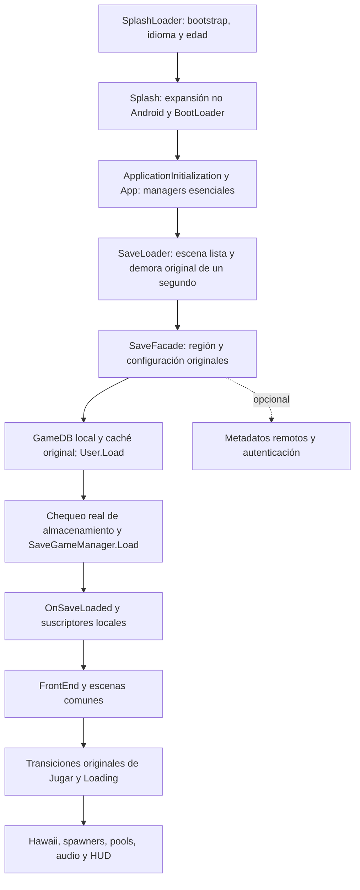

# World: auditoría de arranque y ensayo privado 00.04

Fecha UTC: 2026-11-07; fecha local del encargo: 6 de noviembre, Colombia.
Autorización expresa del propietario para esta auditoría, correcciones, pruebas
Unity 2018 y siguiente VPK privado. **No aprueba fases:** P00 ACTIVE, 0/13 aprobadas,
ledger intacto, main existente. Trabajo de proyecto únicamente en la copia PSP2
Unity 2018.2.19f1 y su caché privada. Unity 2017, base funcional 2018 y Evolution
quedan protegidos. Sin extracción, reconversión, descarga, rama nueva ni publicación.

## Evidencia física vigente: VPK 3 / 00.03

**OWNER-REPORTED:** inicia, límite de 60 FPS funcional, Loading durante un tiempo,
congelación momentánea y retorno al LiveArea sin crash visible. Conservar 60 FPS.
La foto privada recibida tiene SHA-256
`3e4cc8f0bb655bea9c4029d6f2dda9269f1f81da72f159e45937c09d5c23207c`.

**VERIFIED en la foto:** target60/VSync1, Update/s21,0, persistent OK, calidad0;
estado SaveLoader, última operación completada `screen loaded SaveLoader`.
LPDDR **51.380.224 bytes (~49 MiB)**, CDRAM **79.310.496 (~76 MiB)**,
PHYSCONT **27.262.976 (26 MiB)**, managed **7.864.320 (7,5 MiB)**.
Son valores puntuales, no el pico de carga ni prueba de reservas contiguas.
No demuestran OOM ni descartan que ocurra después. **Sin evidencia para activar
ExpandBy109MB**, que continúa None. Update durante carga no invalida el máximo
reportado ni mide presentaciones físicas.

El error muestra explícitamente `FGOL.Server.ClientConnectionError - Online
service unavailable on this offline platform`. **El adaptador HTTP de 00.03 sí
estaba respondiendo.** No es evidencia de una petición HTTP exitosa, un error de
GameDB local o la causa del cierre. No se recibió un dump nuevo ni un log físico
completo. Foto/cierre no identifican todavía la operación fatal.

## Cadena y esperas reales

- `ManagerPrefabLookup.Awake` de SplashLoader inicializa/instancia managers con
  sus prefabs originales; omitirlo puede invalidar una prueba aislada en Editor.
- La edad y las fuentes son condiciones originales de SplashLoader. No se
  inventan edad/consentimiento, callbacks de aceptación ni fuentes sustitutivas.
- `ExpansionFileDownloader` ya completa Success **fuera de Android**, donde los
  datos se compilaron en el player; no se rehízo ese adaptador ni se exige OBB en Vita.
- `SaveLoaderState` espera su escena y un segundo, luego solicita SaveFacade.Load.
  La foto corresponde a esta zona; no muestra que haya acabado la lectura del save.
- `GameDataManager.LoadGameData` descifra/deserializa el TextAsset original
  `Resources/gamedb/gameDB.gdb.bytes` (1.928.000 bytes) y combina cachés originales.
  `GetServerGameData` es una actualización asíncrona separada, invocada desde
  Splash y después de cargar save. Su resultado no es el GameDB obligatorio.
- El guardado conserva `User.Load`, identidad/saveID, cuota, rutas persistentes,
  chequeo de disco, formato, serialización y lectura local. Se elige la capacidad
  local y la opción **original** skipAutoAuth de ContinueLocally; no se fuerza un
  LoadState.OK ni se restablecen preferencias de nube o partidas.
- OnSaveLoaded notifica sistemas locales y SaveLoader pasa a FrontEnd. Después,
  las transiciones originales de Jugar cargan escena/variantes, pools, spawners,
  audio/HUD y esperan eventos de carga y confirmaciones originales de onboarding.
  No se sustituyen estas esperas por SceneManager directo en el VPK.

## Clasificación y decisiones

| Sistema / entrada examinada | Función y dependencia | Decisión para PSP2 |
| --- | --- | --- |
| ManagerPrefabLookup, ManagedUpdates, GameStateMachine, ScreenTracker, CommonSceneDef | Bootstrap, orden y carga de escenas | Esenciales; mantener. Marcas de carga existentes y nuevas de App/Ingame/Loading. |
| LanguageInitializer, AgeGateScene, NativeBinding | Idioma, fuentes y flujo de edad original | Mantener datos y consentimiento. NativeImplementationPSP2 ya evita JNI; no duplicarlo. Las fuentes asiáticas tienen una carga WWW síncrona heredada, no reproducida en este encargo; pendiente si aparece en una traza. |
| Config.Init / HSXServer.Configure e Init | Configuración local, tabla de comandos y **SaveGameManager.Init** | Mantener managers e inicialización local. No desactivar HSXServer entero: también inicializa el guardado. |
| GameDataManager.LoadGameData / LoadCachedData | Reglas, entidades y configuración esenciales | Mantener fuente original y caché, sin JSON inventado, limpieza de caché ni cambio de economía. Marcadores antes/después. |
| GameDataManager.GetServerGameData | Actualización opcional y metadatos de servidor | No arrancar actualización en PSP2. La copia local original existe y fue cargada en pruebas. |
| HSXServer.GetGameData / CheckConnection / GetRunningEvents | Servicios remotos | Completar diferido con null/error, sin conexión exitosa, datos ni eventos ficticios. Restaurar también el callback omitido del error GetGameData en el cuerpo original. |
| Commander y FGOL.Server.Request | Comandos/autenticación previa y BestHTTP | Comandos PSP2 completan error antes de autenticar o crear transporte. Conservar el fallback HTTP ya existente, también ejercitable con PSP2 seleccionado en Editor. |
| AuthManagerUnity, diez operaciones | **UnityWebRequest independiente de BestHTTP**, incluso auto-auth de save | Adaptar cada entrada al constructor de error original y callback diferido único. Sin UnityWebRequest, login/token, hora de servidor o confirmación de compra ficticios. |
| SaveFacade / AuthManager.LoadUser / SaveGameManager / SaveUtilities | Identidad y progreso local; posible espera de nube/auto-auth | Mantener almacenamiento real; capacidad de nube falsa sin reescribir sus preferencias. ContinueLocally usa su skipAutoAuth original. Fallos de disco/corrupción siguen sus rutas originales, no se convierten en PASS. |
| SSLCertManager | Certificados de transporte remoto; importación X509 y descifrado/escritura de certificados | No importar/escribir/descargar certificados en PSP2 offline; colección de certificados vacía. No tocar criptografía del GameDB ni del save. |
| Logging / HSXServer.SendLog | Registro remoto TCP, handler de errores en hilos | No construir ni registrar el emisor remoto en PSP2. Los mensajes enviados a SendLog se conservan en Unity/TTY/diagnóstico local según severidad; no descartarlos por retirar telemetría. Ruta fuera del adaptador HTTP; posible riesgo independiente, **sin prueba de que causara el cierre**. |
| HSXAnalyticsManager / AnalyticsFacade / DNA / AppsFlyer / Facebook / Flurry | Contadores locales y emisores externos | Mantener sistemas y contadores locales; exclusión PSP2 ya funcional conservada. Ejercitar la misma exclusión en Editor PSP2, evitando las NRE DNA del ensayo anterior. |
| SocialFacade, SocialManager, GameServicesFacade, proveedores Null | Integración social y servicios Android | Adaptadores existentes conservados, sin borrar tipos, logros/datos locales o conceder sesiones/recompensas. |
| NotificationManager / NotificationsNull | Registro local y notificaciones OS | Conservar adaptación existente y sus save systems/callbacks, sin reotorgar notificaciones históricas. |
| PushNotificationFacade / Pushwoosh | Registro push; Pushwoosh.Instance crea PushNotificationsAndroid | Estado Rejected y capacidad falsa, sin instanciar SDK Android, registrar push ni borrar preferencias/records persistidos. |
| UbisoftNewsManager.LoadFeed / NewsMessagesManager / PromoManager / InterstitialManager | RSS remoto WWW, promoción y noticias | No descargar feeds en PSP2. Mantener managers, datos y suscriptores; no inventar promoción/recompensa. Ruta distinta de BestHTTP. |
| CP2 / MarketingFacade / GameAdManager y proveedores | Promoción y anuncios opcionales | Protecciones PSP2/NonMobile existentes conservadas; no repetir SDK stubs ni conceder recompensa. Sus managers/datos locales siguen disponibles. |
| BillingFacadePSP2 / HSXStoreManager | Tienda no disponible y datos locales de items | Proveedor existente NotSupported conservado. No eliminar tienda local, precios, inventario ni simular compras/restauraciones. |
| AssetBundleManager / InformationManager / DownloadManager | URLs **Android**, CRC y descargas WebRequest en hilos; fuera de Request | Conservar CRC/cola y poner descargas externas en Blocked con error explícito. No arrancar workers, migrar/borrar cachés ni cambiar callback de contenido a Loadable. |
| AssetBundleLoader / escenas compiladas | Selección bundle frente a escena del player | Escenas incluidas usan loader original. No intentar cargar bundles Android como PSP2; retorno null/false de indisponibilidad, sin assets sustitutos. |
| GameInfo, GameDatabases, ResourceLoaderManager, spawners/pools | Gameplay, assets y bases esenciales | Mantener, sin recortes. Registrar recurso ausente, sin crear placeholder ni cambiar política de caché/GC. |
| AudioManager / Fabric / escenas Audio_Common y Audio_Hawaii | Audio Unity esencial | Conservar 424 clips HEVAG y sus metadatos/load modes. No reconvertir ni eliminar contenido. |
| InControl, HSWPSP2InputProfile/Bindings, InputControlManager, NGUI | Controles/UI | Mantener. Las NRE iniciales ThreeDTouch/InputControlManager del fixture aislado se investigan sin inventar un parche de controles. |
| AntiCheatManager / GameValidator, replay y rutas opcionales no ejercitadas | Integridad local y funciones adicionales | Sin evidencia de causa fatal en este encargo; conservar. La validación de firmas Android ya estaba aislada. No declarar cobertura física completa ni desactivar sistemas por su nombre. |

## Recursos, memoria y límites

23 escenas originales, incluyendo Hawaii low/medium/high y sus spawners/audio.
El código original de bundles ya declara Hawaii disponible localmente. El CRC
incluido enumera otras zonas descargables; sus nombres/CRC **no son los bundles**.
No se marcan esas zonas como cargadas ni se crea contenido faltante. No hay
bundles PSP2 nuevos en este ensayo. La localización/caché Android previa no prueba
que esos datos sean utilizables en PSP2. No se repite recuperación de recursos.

Se conservan los pendientes anteriores de recuperación (51 entradas de catálogo,
dos scripts nulos, referencia Font Texture, shader provisional). No se atribuye
el cierre a ellos sin una referencia/excepción correspondiente. No se cambian
escenas, prefabs, GUID, materiales, texturas, geometría ni overrides de audio.
No se cambian física, timestep, velocidad de animación, calidad o resolución para
inflar FPS. Mantener **60/VSync1**, **BuildOptions.None** y player normal que evitó
el fallo Razor del VPK1. El fallo GfxDeviceGXM/Alloc de Evolution D05 requiere
evidencia equivalente de World antes de considerar expansión de memoria.

## Diagnóstico y referencias Evolution

Se reutiliza el método documentado D03/D04/D05 y la guía World: localizar la etapa
real, usar proveedores no disponibles y completar callbacks de fallo, comprobar
datos locales y separar errores de SDK/audio/OOM. No se copian clases, codec,
identidad ni configuraciones de Evolution. Sus documentos/código se leen sin editar.

00.04 conserva las marcas previas y añade chequeo de disco, carga local de save,
GameDB, managers App, entrada Ingame y siguiente estado. Franja y archivo distinguen
**primer error**, **último error** y **última excepción**, evitando que un error
remoto inicial oculte uno posterior. Excepciones tienen presupuesto separado del
ruido de errores; se muestra antigüedad de etapa y callbacks pendientes/completados.
Se mantienen memoria de tres pools, archivo único con flush en la ruta persistente
real y Unity/TTY; sin depender de escrituras directas ux0 ni forzar finalizaciones.

## Resultados locales y pendientes

Evidencia privada `Reports/PSP2_VPK04`: foto/transcripción, Before_Private,
checkpoint reversible Before_VPK04, lista exacta de fuentes, compilación y pruebas.
Inputs originales referenciados, sin extracción nueva: APK SHA-256
`6bf41929985b556e6729f3696a02d687da119b04ced1c5cb13590f4ce69fab9d`, OBB
`c35c6daf1514977fdba2101ea994fcbb244f0a757a74b908c1dc3c6203847d72`.
Unity **2018.2.19f1**, Mono/C#4/.NET2 Subset y herramientas locales existentes.

**VERIFIED compilación dirigida inicial PSP2 sin UNITY_EDITOR:** 118 fuentes
firstpass / 3.740 principales, cero errores, 81/510 warnings. Tras completar la
auditoría se añadieron guardas de comandos y RSS para probar en Editor; la ejecución
del Editor vuelve a compilar esas fuentes. El primer intento del runner mcs buscó
Library en la copia permanente sin caché; se usó la caché existente. Dos aserciones
del aplicador fallaron antes de escribir (ancla repetida y firma pública de método),
se precisaron sin rehacer hashes ni extracción.

**VERIFIED primer Play aislado de BootLoader (50 s):** 14 callbacks de control con
fallo único/diferido, sin handles UnityWebRequest de autenticación ni mutación de
identidad/preferencias de nube; GameDB con 153 EdibleData, Hawaii disponible por
regla original. Alcanzó FrontEnd e Ingame/escenas de Hawaii/audio. Registró tres
excepciones de managers, conservadas; no es PASS limpio. Omitía inicialización de
SplashLoader necesaria para InputControlManager. Se corrige **el fixture**, sin
modificar controles, y se repite desde su bootstrap original. Una continuación
controlada del fixture permite probar BootLoader sin aceptar ni cambiar la edad;
esa continuación no se compila en el player ni acredita interacción física.

Pruebas posteriores y recibo de build/paquete se añaden al terminar. El objetivo
físico sigue siendo Loading → FrontEnd → inicio de gameplay. Hasta una nueva
prueba en consola, la causa del cierre de 00.03 permanece **sin confirmar**.

**VERIFIED segundo Play (50,01 s / 2.091 frames):** bootstrap original SplashLoader
seguido de continuación del fixture hacia BootLoader, sin aceptar/cambiar edad.
**Cero errores durante Play**, los 14 callbacks de control vuelven a pasar, sin
mutación de identidad/nube ni handles Auth UnityWebRequest, cero callbacks pendientes.
GameDB local: 153 EdibleData. Disco y lectura local devuelven OK en los marcadores.
FrontEnd se alcanza alrededor de 7 s, Ingame alrededor de 15 s, player activo al
final; escenas de Hawaii, sus spawners, pools y audio cargadas. Se invoca la
transición original FrontEnd/Play; no se crea una escena de gameplay artificial.
target60/VSync1, timeScale1 y fixedDeltaTime0,01666665 conservados. Esto prueba
inicialización/cargas en Editor; no prueba botones, render, sonido ni memoria Vita.

Al **detener Play** reaparece el error heredado de intentar destruir Transform de
`PF_Water_Wake_S(Clone)`, ya registrado antes de este encargo. Se conserva como
pendiente de teardown; no se atribuye a él el cierre físico durante Loading.
La captura PNG solicitada por el fixture batch no se produjo: no se declara una
verificación visual a partir de ese intento. Pruebas ejecutadas con una instancia
oculta batch de la copia privada en caché, no en la ventana del Editor del usuario.

**VERIFIED compilación PSP2 final dirigida:** 3.740 fuentes principales, cero
errores / 514 warnings; firstpass sin cambios reutilizado desde el preflight PASS
de 118 fuentes. El build nativo usa después la misma configuración normal.

La escritura local también se conserva al guardar: `SaveFacade.Save` sigue
SaveSystems → InternalSave → SaveToDisk antes de cualquier agenda de upload.
La capacidad remota permanece falsa tras la carga PSP2, por lo que la condición
original de ScheduleUpload no habilita subir una partida por tener preferencias
antiguas de nube. No se vacían User/saveID, credenciales ni el save para forzar
arranque y no se convierte la falta de red en sincronización exitosa.

El primer candidato nativo 00.04 compiló y pasó auditoría de 41 checks y paquete,
pero se archivó **antes de entrega** para conservar también los mensajes que
antes solo enviaba `HSXServer.SendLog` a telemetría. La revisión sustituye ese
destino por Unity Debug/TTY local según severidad, manteniendo desactivado TCP;
no modifica la lógica de guardado ni gameplay. Se recompila esa corrección y se
vuelven a verificar player/paquete; resultados del candidato anterior permanecen
en BeforeLocalLog, sin reinterpretarlos como fallo físico ni PASS de consola.

## Entrega final 00.04 y siguiente prueba

**VERIFIED build final:** Unity2018.2.19f1/PSP2 Mono2x, `BuildOptions.None`,
`-batchmode -quit -buildTarget PSP2 -projectPath <copia_privada>
-executeMethod HSWFirstVitaBuild.Build -logFile <privado>`.
**Succeeded, 0 errores / 596 warnings, 3:02,263**. Player normal idéntico al SELF
de 00.02/00.03; sin DEVELOPMENT_BUILD y con HSW_PSP2_BOOT_LOG. No hay parche de
binario propietario ni cambio de expansión de memoria.

**VERIFIED player final:** **42 comprobaciones IL** y **78 marcadores**. Los diez
transportes Auth no crean solicitudes; los comandos fallan antes de autenticar;
HSX mantiene SaveGameManager.Init y registra SendLog localmente. Base GameDB/cachés,
chequeo real de disco y SaveToDisk conservados. Sin workers/URLs de bundles Android,
RSS/push/certificados remotos en las rutas adaptadas. Proveedores offline y perfil
de entrada existentes conservados; no se declara eliminación de todas las clases SDK.

**VERIFIED recursos/preservación:** 23 escenas en el orden original, 480 texturas
compatibles, 424 HEVAG con canales/frecuencia/duración/load mode y recursos iguales,
140 shaders/245 passes ConsoleVS/ConsoleFS. Registros de conversión y reimportación
vacíos. Ningún asset/escena/prefab/meta original o control fue cambiado/eliminado;
el helper de FPS es idéntico al de 00.03. Manifiestos 2017 (20.870 archivos) y base
funcional 2018 (20.887) sin cambios. Settings solo avanzan versiones00.03→00.04.
VPK3 anterior conservado con SHA original. Fases y rama intactas.

**VPK privado:**
`local-work/HSW_Recovery/Reports/PSP2_VPK04/HSW_Vita_Test_00.04_HGSKW1178.vpk`.
**179.698.123 bytes**, 284 entradas, TITLE_ID **HGSKW1178**, APP_VER **00.04**,
ATTRIBUTE2=0. SHA-256:
`b457bcf8effc5d0ca9188a3c15c4c494e3f2e795b1dd6bab68af1c56dcc9359a`.
CRC y comparación de cada miembro con **su propio player generado** PASS, excepto
la adaptación de identidad de param.sfo. ID técnico interno AOT conservado como
antes, sin parchear su módulo. Recibos, símbolos exactos y fuentes/checkpoints
siguen privados. No se publica ni se instala automáticamente.

**Prueba física pendiente:** instalar encima de HGSKW1178/00.03, sin borrar saves,
edad, preferencias o plugins. Mantener la configuración ya usada con CapUnlocker.
Comprobar en orden: Loading → menú → Jugar → carga de Hawaii, audio y controles.
Confirmar máximo60 y registrar tiempo/última pantalla. No certificar gameplay por
el resultado del Editor ni interpretar que otras zonas descargables están presentes.

Si vuelve al LiveArea, conservar video/foto de **LATEST**, **EXCEPTION**, últimas
BEFORE/DONE, antigüedad de etapa y tres pools de memoria; conservar el dump **nuevo**
y `HSW_VPK04_*.log` de la ruta persistente real/montada. Un contenedor cifrado del
savedata no es un log de texto ni evidencia de ausencia de errores. La escritura
directa ux0 no se necesita. Diagnóstico nuevo permite separar fallo de GameDB,
almacenamiento, save, suscriptor, escena, memoria o salida voluntaria.

**Sin confirmar:** causa exacta del cierre físico de 00.03, comportamiento físico
de 00.04, memoria pico/contigua, render/control/audio/save y estabilidad en consola.
Las rutas remotas encontradas y corregidas son hechos de código y contratos; no
se presentan como una explicación demostrada del retorno anterior al LiveArea.
